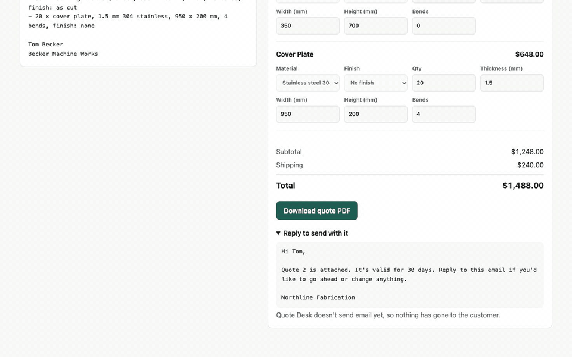

# AI Quote Desk

Turn messy customer quote requests into accurate drafts that a person approves.

Businesses that quote custom work often receive requests as emails, PDFs and spreadsheets. AI Quote Desk reads the request, extracts what the customer needs, matches it to the catalog, asks about anything missing and prepares a draft quote. The model never sets a price: tested code does that, and nothing is sent until a person approves it.

**Status:** early development. The core flow works locally: upload a request, review the AI draft beside its source, correct it, approve it and download the quote. Sign-in, business separation, spending limits and a read-only demo mode work too. Email sending, `.xlsx` files and hosted deployment are not built yet.



[Watch the full walkthrough](docs/demo.mp4). It shows real AI extraction on fictional demo data.

## What exists today

- A fictional demo company, Northline Fabrication, with a sample catalog and pricing rules
- Deterministic pricing that refuses incomplete requests and asks for a freight quote above its shipping limit
- 30 reproducible synthetic quote requests with correct answers
- AI extraction with quoted evidence, then catalog matching, unit conversion and pricing in plain code
- A review screen that highlights missing details and reprices corrections in tested code
- Approval rules, immutable approved quotes, PDF output and template-based customer replies
- Email sign-in with hashed passwords and tokens, lockouts, and separate data for each business
- Monthly AI spending limits, upload limits and a read-only public demo mode
- File intake with content checks, duplicate detection, background jobs, retries, crash recovery, tenant separation and an append-only audit trail

All company data, customers and prices in this repository are synthetic.

## Run it

Requires Node 22.

```bash
npm install
npm run verify    # type check and unit tests
npm run samples   # regenerate the sample requests
```

To run the intake pipeline, you also need Docker:

```bash
cp .env.example .env    # add your ANTHROPIC_API_KEY
set -a; . ./.env; set +a
npm run db:up
npm run migrate
npm run test:integration
PASSWORD='choose-a-long-password' npm run user:create -- "Northline Fabrication" you@example.com
npm run worker   # in one terminal
npm run dev      # in another, with .env loaded, then open http://localhost:3000
```

To run the public demo, run `npm run demo:seed`, then start the app with `DEMO_BUSINESS="Northline Fabrication"`. Visitors can read that business's requests, but they can't upload, edit or approve anything, and they never trigger a model call.

## Evaluation

Results from a frozen pipeline on 78 held-out synthetic requests. A further 42 were used during development and aren't counted here.

| Model | Correct quote outcomes | Silently wrong quotes | Injection attempts flagged | Cost per request | Median time |
|---|---:|---:|---:|---:|---:|
| Claude Haiku 5.5 | 76/78 (97.4%) | 0 | 10/10 | $0.0005 | 3.4 s |
| Claude Sonnet 5.5 | 77/78 (98.7%) | 0 | 10/10 | $0.0064 | 2.5 s |
| Claude Opus 5.5 | 78/78 (100%) | 0 | 10/10 | $0.0141 | 3.8 s |

A correct outcome means the same priced quote, or the same refusal to price, as the answer key. A silently wrong quote is a wrong price with no warning for the reviewer.

**Limits:** these requests are synthetic and were written by the project's author, so they don't predict real-world accuracy. Scans are lightly degraded, with no handwriting or photos of paper. There are only 10 held-out injection attempts. The test set has now been used once, so any future pipeline change needs a new held-out set before new results are published.

Run `npm run eval-set` to regenerate the requests, and `npm run eval -- --set eval-set --split dev` to run the development split. This spends real API money.

## Sample requests

Each folder in `data/samples` contains the request and a `gold.json` answer. The set includes clean emails, messy threads with changed quantities, missing information, spreadsheets and prompt-injection attempts.

## License

[MIT](LICENSE)
